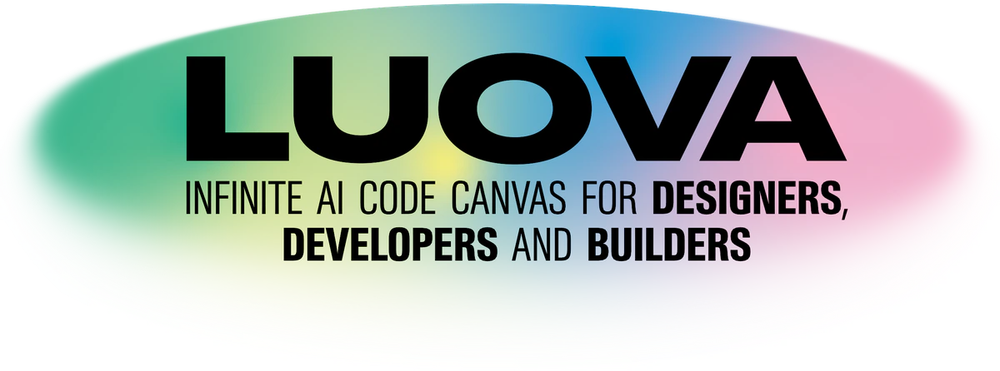

<div align="center">
  



Luova is an open-source infinite visual canvas that lets you design and build apps, websites, slides, and interactive web components with AI for free. It runs locally, and exports production-ready code.

</div>

---

## Why Luova?

- Local-first AI with optional frontier providers supported, free and works fully offline
- Infinite visual canvas for Figma-like workflows and creative iteration
- Visual editing, AI editing, and direct code editing in one app
- Exports clean React, Tailwind, and Next.js projects as code, no prototypes or handoffs
- Extensible, customizable and open source under Apache 2.0 license

---

## Features

| Feature | Description |
| --- | --- |
| **Local AI, No Cost** | Optimized for use with local LLMs from your own machine. Build without paying for API tokens or subscriptions. |
| **Wireframe to Code** | Draw wireframes on the canvas and let AI translate your drawings into deployable React and Tailwind components. |
| **Surgical Visual Edits** | Make targeted visual edits using sliders, inputs, handles, without spending tokens. |
| **Live Preview** | Compiles React, TypeScript, and Tailwind directly in the canvas. Edit components in the integrated code editor live and see changes instantly. |
| **Offline Asset Workflow** | Drag React components and images directly onto the canvas. Custom fonts and image assets are stored locally, keeping your projects fast, private, and fully offline. |
| **Design Systems** | Generate complete design system tokens for colors, typography, spacing, and shadows across light and dark themes. |
| **Theme Presets** | 43 editable theme presets with light and dark variants, powered by global OKLCH color controls. |
| **MCP Support** | Connect Luova canvas to your existing AI subscriptions and agent harnesses. |
| **Frontier Model Support** | Connect with ChatGPT subscription, or OpenAI, Anthropic, Google, OpenRouter using standard API keys. |


---

## Quick Start

You need **Node.js version 22.0.0** or higher.

```bash
git clone https://github.com/paulilaaso/luova.git
cd luova
npm install
npm run dev

```

Open the canvas at `http://127.0.0.1:3000` in your favorite browser (Chrome recommended).

---

## Modes

Luova switches between different modes depending on what you have selected on the canvas.

### Create

Active when nothing is selected. Use this to generate brand new components based on prompting with natural language, or combine with wireframes to generate based on the positioning and dimensions of the wireframes.

https://github.com/user-attachments/assets/7ee52627-64d2-4eb2-a85b-6f28ccaa0c12

### Edit

Active when a single component is selected. Refine the selected component with AI prompts, or select elements and use the visual dashboard to adjust spacing and styling.

https://github.com/user-attachments/assets/5f784d70-31cf-4005-8953-2c956b7ff8a4

### Recreate

Active when an image is selected. Resize it on the canvas to set the output size, then click **Recreate** to turn it into a component (instructions optional). Or right-click **Recreate** and select **Recreate with Theme** to create a theme and component together.

https://github.com/user-attachments/assets/6466db76-3094-4c5f-851d-36e760302cfd

### Bake

Active when multiple components are selected simultaneously. Merge multiple components and wireframes into a single clean component.

https://github.com/user-attachments/assets/4f620397-9c8f-4fc7-95b6-cf9ac678d36f

### Theme

Active when the Theme tab is open. Change design system variables including OKLCH colors, typography, spacing, borders and complex shadow layers. Prompt with natural language or select image on the canvas the create theme based on the image.

https://github.com/user-attachments/assets/a85a406b-b3b0-474d-97cf-f16b398ae251

### Code

Edit a selected component's code in the Code tab and see your changes live on the canvas. In edit mode, right-click an element and select Go to Code to jump directly to where it’s defined.

---

## Usage

### Optimized Build

Run an optimized version of Luova:

```bash
npm install
npm run build
npm run start

```

### Workflows

Luova supports six complementary workflows. Switch between them at any time:

| Method | Cost | Description |
| --- | --- | --- |
| **Visual Dashboard** | Free | Edit padding, margins, alignment, borders, typography, colors and more with dashboard handles and inputs. |
| **Local LLM Integration** | Free | Prompt local AI models through servers like LM Studio or Ollama. |
| **Direct Code Editor** | Free | Edit components by hand in the integrated code editor. Compile checks run locally in your browser. |
| **MCP Integration** | No additional cost | Send instructions from your IDE or AI agent (Cursor, Codex, Claude Code, GitHub Copilot, etc) to the canvas via Model Context Protocol. |
| **ChatGPT Plan** | Included in your ChatGPT plan | Sign in with your ChatGPT account to generate using your plan's usage limits. |
| **API Provider** | Free / Pay per token | Connect to OpenRouter (limited free use), Google (limited free use) Anthropic, or OpenAI. Pick cheaper or free models to keep costs down. |

### Keyboard Shortcuts

| Shortcut | Action |
| --- | --- |
| `Space + Drag` | Pan the canvas |
| `Cmd/Ctrl + Scroll` | Zoom the canvas |
| `Alt + Click/Drag` | Draw a wireframe placeholder |
| `Cmd/Ctrl + Z` / `Y` | Undo / Redo |
| `Cmd/Ctrl + C / X / V` | Copy / Cut / Paste selected components |
| `Cmd/Ctrl + D` | Duplicate selected components |
| `Backspace / Delete` | Delete selected components |
| `D` | Toggle dark/light mode |
| `E` | Toggle element capture for edit |
| `G` | Toggle grid |
| `Arrow Keys` | Nudge selected component by 1px (`Shift` for 10px) |

### Exporting

Export your canvas or selected components as a structured Next.js project featuring TypeScript, Tailwind CSS, and your design system.

1. Click Export to download the ZIP file.
2. Unzip the downloaded file.
3. Run:

**Standard Setup:**

```bash
cd luova-project-export
node setup.js
cd luova-app
npm run dev

```

**Alternative One-Liner:**

```bash
unzip -q luova-project-export.zip -d luova-project-export && cd luova-project-export/ && node setup.js && cd luova-app && npm run dev

```

---

## Configuration

### Setting up AI Providers
Open **Settings (gear) icon** to configure your AI models.
- **ChatGPT:** Select the "ChatGPT (Plan)" provider, click **Continue with ChatGPT** and approve plan usage to generate with your ChatGPT plan.
- **Cloud:** Enter your API keys for OpenAI, Anthropic, Google, or OpenRouter.
- **Local:** Select the "Local" provider and enter your local endpoint (e.g., `http://localhost:1234/v1` for LM Studio/Ollama).

### Model Context Protocol (MCP) Setup
You can control the Luova canvas directly from your favorite MCP-compatible IDE or AI agent (like Cursor, Claude Code, Codex, OpenCode, GitHub Copilot).

1. Enable MCP in the Luova Settings dialog and copy the MCP URL shown there. It looks like `http://127.0.0.1:3000/api/mcp?token=…` and includes a private per-install token (stored in `.luova/mcp-token`).
2. In your MCP client configuration, add a new server (type: streamable HTTP).
3. Paste the copied URL as the server URL. Clients that support custom headers can instead use `http://127.0.0.1:3000/api/mcp` with the header `Authorization: Bearer <token>`.

### Adding Custom UI Components

To make new components available to the AI on the canvas, register them in the sandbox runtime using these three steps. Example below uses a Shadcn component:

1. **Add the component to your project:**
   Install the component (which places the file in your `components/ui/` directory):
   ```bash
   npx shadcn@latest add accordion
   ```

2. **Register it in `config/runtime-scope.ts`:**
   Add the component module to the static `RUNTIME_SCOPE` map so it bundles into the execution sandbox:
   ```typescript
   import * as Accordion from "@/components/ui/accordion";

   export const RUNTIME_SCOPE: Record<string, any> = {
     // ... existing entries
     "@/components/ui/accordion": Accordion,
   };
   ```

3. **Instruct the AI in `lib/ai/prompt-factory.ts`:**
   Add a brief description to the `RUNTIME_SCOPE_CONTEXT` template string so the AI knows how to import and use the newly available primitive:
   ```typescript
   - \`@/components/ui/accordion\`: Standard Shadcn Accordion for collapsible sections. Import: import { Accordion, AccordionItem, AccordionTrigger, AccordionContent } from '@/components/ui/accordion'
   ```

---

## Acknowledgements

Luova's theme system is adapted from [tweakcn](https://github.com/jnsahaj/tweakcn)
by [Sahaj Jain](https://github.com/jnsahaj), licensed under the
[Apache License 2.0](https://github.com/jnsahaj/tweakcn/blob/main/LICENSE).

---

## License

Apache License 2.0. See [LICENSE](LICENSE) for details.
